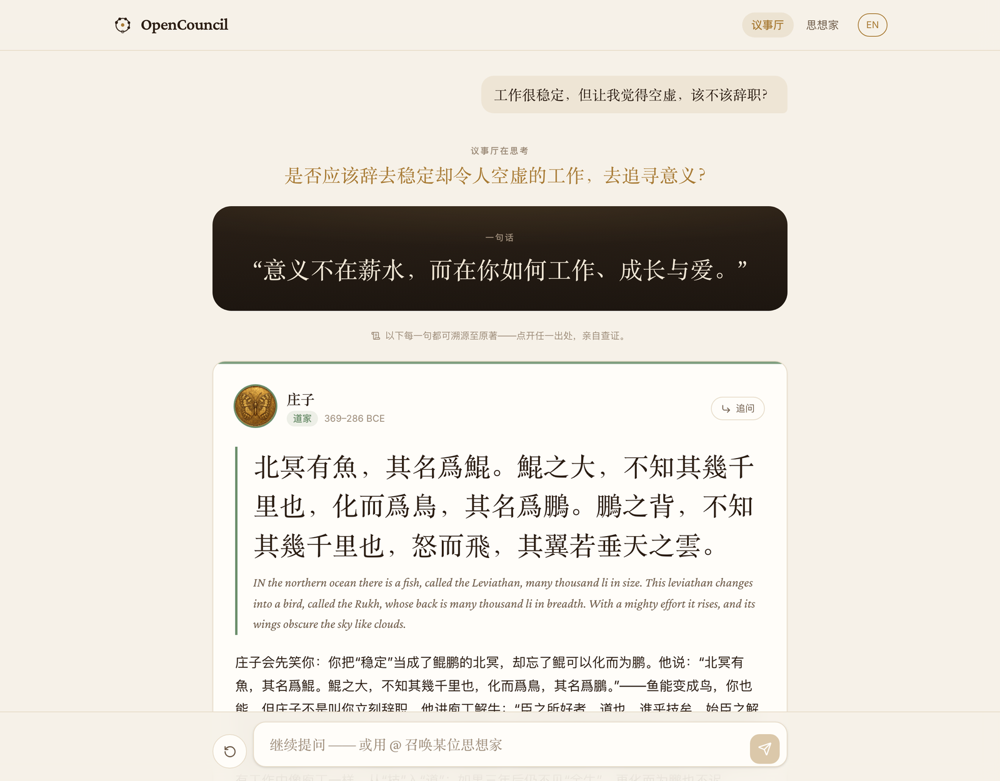

# OpenCouncil

[中文](README.md) · **English**

Ask a question about life. A council of thinkers from different traditions answers, each quoting their own texts, and then says where they agree and, by name, where they differ.

- **Live demo**: <https://council.linjiejim.com>
- **Design notes** (Chinese): [DESIGN.md](DESIGN.md) — why it works this way and what it deliberately doesn't do
- **Sources and licenses**: [NOTICE.md](NOTICE.md)

> The interface is bilingual (Chinese / English); the design notes and deployment guide are in Chinese. Code, data formats and commands are language-neutral.



## What it is

It's 2 a.m. and you want to know how to live with a loss, or whether to quit your job. OpenCouncil doesn't hand you one answer. It convenes Confucius, Zhuangzi, Marcus Aurelius, Kant, Rumi and others, lets each speak in turn, and shows the original text behind every quotation:

- **Many voices**: Confucian, Daoist, Buddhist, Christian, Islamic, Stoic, Greek, Enlightenment and modern thought, side by side on the same question.
- **Real quotations**: no quotation is written by the model. Original text and translation are taken **verbatim** from public-domain or openly licensed editions and pass a verification gate before they enter the corpus; every quotation opens to its original, its translator and a link to the source.
- **Context**: each passage carries a note on when it was written, to whom, and where it stops applying.
- **Consensus and named disagreements**: the council closes with one sentence on where the thinkers agree and one to three concrete disagreements that name who disagrees. Anything inferred beyond the text is marked as inference.

242 passages from 16 thinkers and scriptures:

| Tradition | Included |
| --- | --- |
| Confucian | Confucius, *Analects*, 26 (Legge) · Mencius, 11 (Legge) · Wang Yangming, *Chuanxi Lu*, 8 (Henke) |
| Daoist | Laozi, *Tao Te Ching*, 20 (Legge) · Zhuangzi, 11 (Giles) |
| Buddhist | *Dhammapada*, 45 (Pali; Sujato) |
| Christian | *The Gospels*, 21 (SBLGNT Greek; World English Bible) |
| Islamic | *The Quran*, 39 (Tanzil Arabic; Pickthall) |
| Sufi | Rumi, *Masnavi*, 1 (Persian; Whinfield) |
| Greek | Plato, *Dialogues*, 9 (Jowett) · Aristotle, *Nicomachean Ethics* and *Politics*, 9 (Chase, Ellis) |
| Stoic | Marcus Aurelius, *Meditations*, 6 (Long) · Seneca, *Letters* and dialogues, 8 (Stewart, Gummere) · Epictetus, *Discourses* and *Enchiridion*, 10 (Long) |
| Enlightenment | Kant, the *Critiques* and *Perpetual Peace*, 10 (Meiklejohn, Abbott, Hastie) |
| Modern | Nietzsche, *Zarathustra*, *Beyond Good and Evil*, *Twilight of the Idols*, 8 (Common, Zimmern) |

Buddhism, Christianity and Islam appear as their scriptures ("Buddhism · The Dhammapada" and so on). The council describes what those texts teach in the third person and never speaks as the Buddha, Jesus, the Prophet or God. Instead of portraits, each thinker has an emblem drawn from their own works: a council that refuses to invent quotations shouldn't invent faces either.

## Running locally

Requires Node 22+, pnpm and Docker.

```bash
pnpm install
```

```bash
cp .env.example .env
```

Put a `DEEPSEEK_API_KEY` in `.env` (needed for the council and for Chinese search; browsing works and English search work without it).

```bash
docker compose up -d
```

```bash
npx drizzle-kit push --force && pnpm content:import
```

```bash
pnpm dev
```

Open <http://localhost:5173>. The API runs on port 3001; the Vite dev server proxies `/api`.

## The content pipeline

```bash
pnpm content:excerpt-check marcus-aurelius   # check a work's anchored excerpts; prints each original + translation
pnpm content:collect marcus-aurelius         # fetch → verify → write packages/content/src/data/*.json
pnpm content:import                          # load data/*.json into the database (idempotent, offline)
pnpm content:notice                          # regenerate NOTICE.md from the data
```

- Original text and translations may only come from the source adapters in `packages/content/src/sources/`, or from anchored excerpts in `packages/content/src/excerpts/`: you give the URL of a whole public-domain book plus the first and last words of a passage, and the program cuts out what lies between. If an anchor is missing or ambiguous, the passage is dropped.
- Summaries, similar questions and context notes are editorial metadata, stored separately from the quotations.
- `pnpm test` checks that every committed passage is verified and fully sourced, and that `NOTICE.md` is in sync with the data.

To add a thinker: add them to `packages/db/src/seed/index.ts`, write an excerpt list in `packages/content/src/excerpts/` modelled on `marcus-aurelius.ts`, register it in `excerpts/index.ts`, and run the commands above.

## Layout

```
apps/web          React 19 + Vite + Tailwind v4, bilingual UI
apps/api          Hono API; also serves the built front end
packages/db       Drizzle ORM + PostgreSQL full-text search
packages/content  source adapters, anchored excerpts, verification gate, import
packages/types    shared types
docs/agent-api.md a read-only retrieval API for other agents
```

To self-host, see [DEPLOY.md](DEPLOY.md) (Chinese).

## License

The code is MIT-licensed ([LICENSE](LICENSE)). Source texts, translations, editorial metadata and emblem images are not covered by the MIT license; see [NOTICE.md](NOTICE.md). Most texts are public domain; Perseus Greek and Latin texts are CC BY-SA 4.0, the SBLGNT is CC BY 4.0, and the Tanzil Quran text is CC BY 3.0 (no modification allowed); editorial metadata and emblems are CC BY 4.0.

The council's explanations are generated by a language model from the quoted passages and can be wrong; the quotations are what you can check. These texts are offered for reflection, not as religious, medical, legal or other professional advice.
